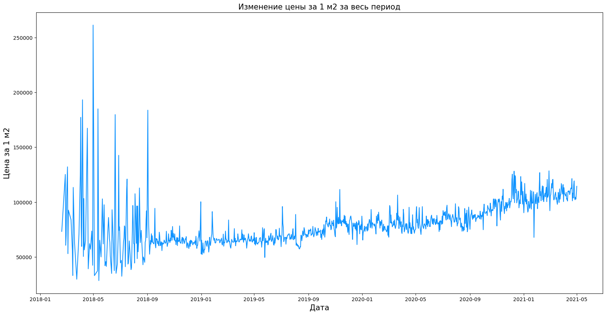

# Рынок жилой недвижимости РФ 2018–2021: 5,4 млн объявлений

🇷🇺 Русский · [🇬🇧 English](#-english)

**Задача.** Исследовать рынок жилья в России по цене за 1 м²: очистить данные, восстановить пропуски, найти факторы цены, определить выгодное время для покупки и продажи, проверить собственную гипотезу и построить модель прогноза цены.

**Данные.** 5 477 006 объявлений о продаже квартир (февраль 2018 – май 2021): дата, регион, тип дома, этаж и этажность, число комнат, площадь, площадь кухни, тип рынка (первичный/вторичный), цена. Учебная версия открытого датасета [Russia Real Estate 2018–2021](https://huggingface.co/datasets/daniilak/Russia_Real_Estate_2018_2021).

**Формат.** Индивидуальная контрольная работа, курс «Анализ данных», 3 курс.



## Что сделано

1. **Очистка 5,4 млн строк:** логические аномалии (этаж выше этажности, кухня больше квартиры, некорректное число комнат), дубликаты на вторичном рынке, выбросы по введённым метрикам «цена за 1 м²» и «площадь на 1 комнату». Удалено всего 2,65% данных.
2. **Восстановление 252 тыс. пропусков** площади кухни моделью Random Forest (R² = 0,67, MAPE = 14%).
3. **Feature engineering:** цена за 1 м², площадь на комнату, доля кухни, относительный этаж, тип этажа (первый, средний, последний), сезон и месяц.
4. **Исследование рынка:** регионы, тип рынка, комнатность, материал дома, этажность, динамика цены.
5. **Когда выгодно покупать и продавать:** сезонность и помесячный анализ числа объявлений, их суммы и средней цены отдельно для первичного и вторичного рынка.
6. **Собственная гипотеза** «цена за 1 м² на нижних и верхних этажах различается»: проверка через бакетирование и t-тест.
7. **Модель прогноза цены:** Random Forest, анализ важности признаков.

## Ключевые результаты

- **Регионы:** Москва (~203 тыс. ₽/м²) и Санкт-Петербург (~132 тыс. ₽/м²) заметно опережают остальные регионы. В топ-10 неожиданно вошли Крым, Амурская область и северные округа (ЯНАО, ХМАО).
- **Динамика:** после волатильного 2018 года цена за 1 м² стабильно растёт, особенно с конца 2020 года.
- **Первичный рынок** дороже вторичного. Выше всего цена за 1 м² на средних этажах.
- **Тайминг сделок:** если смотреть по сезонам, покупать выгоднее летом. По месяцам самые выгодные покупки в мае на первичном рынке и в декабре на вторичном. Продавать на вторичном рынке выгоднее весной, особенно в апреле.
- **Гипотеза подтвердилась:** средняя цена за 1 м² на нижних этажах выше, чем на верхних (p < 0,001).
- **Модель цены:** Random Forest, **R² = 0,88, MAPE ≈ 18%**. Самые важные признаки: общая площадь и регион.

<p>


</p>

## Чему я научился на ошибке

В первой версии модели среди признаков была **цена за 1 м²**, и R² получился 0,9997. Это утечка целевой переменной: цена объекта = цена за 1 м² × площадь. Корректная модель без этого признака даёт R² = 0,88. В ноутбуке это отмечено.

## Ограничения и что бы я улучшил

- Код региона закодирован числом и используется как числовой признак. Лучше применить target encoding или градиентный бустинг с категориальными признаками (CatBoost).
- Для прогноза цены нужна временная валидация (обучение на прошлом, тест на будущем), а не случайный split.

## Стек

Python · pandas · NumPy · SciPy · scikit-learn · seaborn · matplotlib

## Как запустить

Полный датасет (~250 МБ) в репозиторий не включён. Скачайте его [отсюда](https://huggingface.co/datasets/daniilak/Russia_Real_Estate_2018_2021) и положите в `data/realty_18_21.csv`. Справочник регионов уже лежит в `data/region.csv`.

```bash
pip install pandas numpy scipy scikit-learn seaborn matplotlib jupyter
jupyter notebook notebooks/real_estate_analysis.ipynb
```

---

## 🇬🇧 English

**Russian housing market 2018–2021: 5.4M listings**

**Goal.** Analyse price per m², clean a 5.4M-row dataset, impute missing values, identify price drivers, find the best time to buy or sell, test a custom hypothesis, and build a price model. Individual university assignment.

**What was done**
- Cleaned logical anomalies, duplicates and outliers, removing only 2.65% of the data.
- Imputed 252k missing kitchen areas with a Random Forest (R² = 0.67).
- Feature engineering, regional analysis and seasonality by primary and secondary market.
- Bucketed t-test for the hypothesis that price per m² differs between lower and upper floors.
- Random Forest price model.

**Key findings**
- Moscow (~203k RUB/m²) and St Petersburg (~132k RUB/m²) lead by a wide margin.
- Price per m² has grown steadily since late 2018, with an acceleration in late 2020.
- New-build flats are more expensive than resale, and lower floors are pricier per m² than upper floors (p < 0.001).
- Price model: **R² = 0.88, MAPE ≈ 18%**. Total area and region are the top features.

**Lesson learned.** An early model version included price per m² as a feature and reached R² = 0.9997. That was target leakage (price = price per m² × area), and it is flagged in the notebook.

**Stack:** Python, pandas, NumPy, SciPy, scikit-learn, seaborn, matplotlib.
