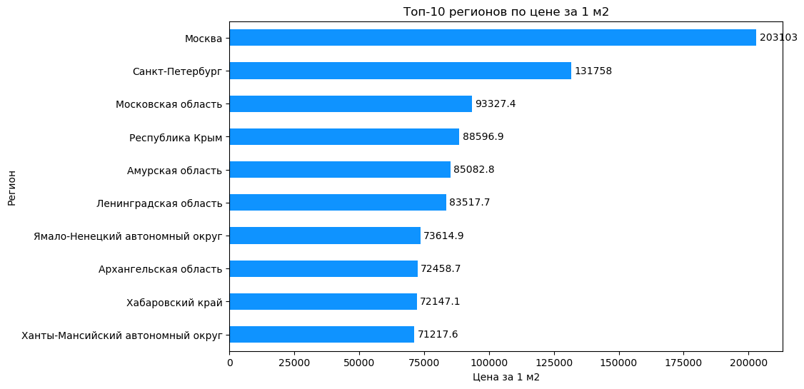
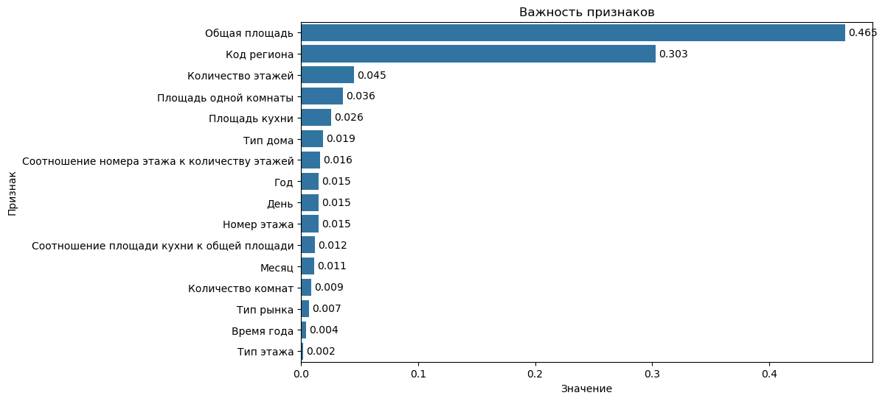
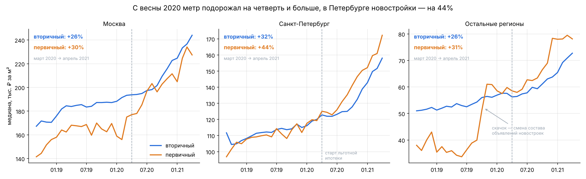
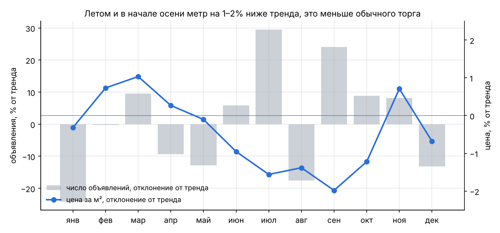
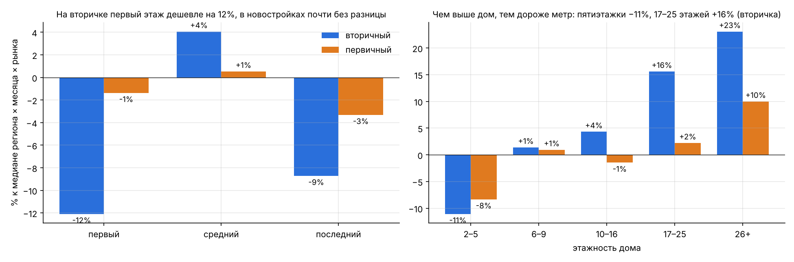
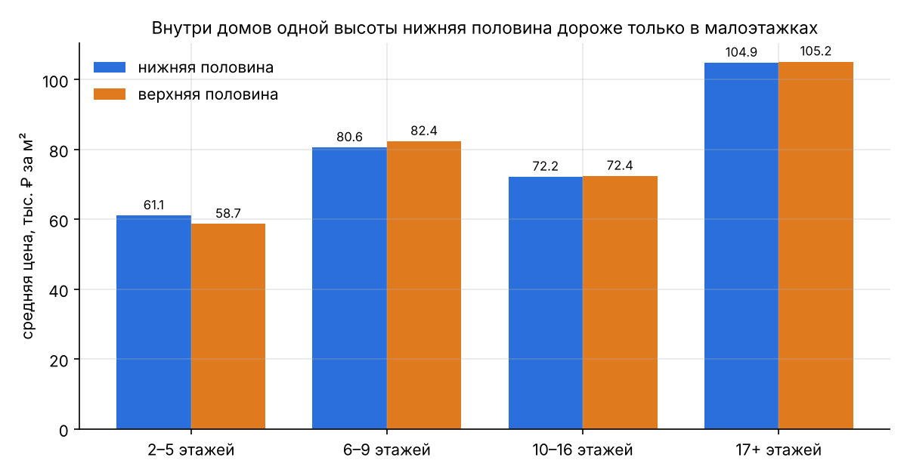

# Рынок жилой недвижимости РФ 2018–2021: 5,4 млн объявлений

🇷🇺 Русский · [🇬🇧 English](#-english)

**Задача.** Исследовать рынок жилья в России по цене за 1 м²: очистить данные, восстановить пропуски, найти факторы цены, определить выгодное время для покупки и продажи, проверить собственную гипотезу и построить модель прогноза цены.

**Данные.** 5 477 006 объявлений о продаже квартир (февраль 2018 – май 2021): дата, регион, тип дома, этаж и этажность, число комнат, площадь, площадь кухни, тип рынка (первичный/вторичный), цена. Учебная версия открытого датасета [Russia Real Estate 2018–2021](https://huggingface.co/datasets/daniilak/Russia_Real_Estate_2018_2021).

**Формат.** Индивидуальная контрольная работа, курс «Анализ данных», 3 курс.


## Что сделано

1. **Очистка 5,4 млн строк:** логические аномалии (этаж выше этажности, кухня больше квартиры, некорректное число комнат), дубликаты на вторичном рынке, выбросы по введённым метрикам «цена за 1 м²» и «площадь на 1 комнату». Удалено всего 2,65% данных.
2. **Восстановление 252 тыс. пропусков** площади кухни моделью Random Forest (R² = 0,67, MAPE = 14%).
3. **Feature engineering:** цена за 1 м², площадь на комнату, доля кухни, относительный этаж, тип этажа (первый, средний, последний), сезон и месяц.
4. **Исследование рынка:** регионы, тип рынка, комнатность, материал дома, этажность, динамика цены.
5. **Когда выгодно покупать и продавать:** сезонность и помесячный анализ числа объявлений, их суммы и средней цены отдельно для первичного и вторичного рынка.
6. **Собственная гипотеза** «цена за 1 м² на нижних и верхних этажах различается»: проверка через бакетирование и t-тест.
7. **Модель прогноза цены:** Random Forest, анализ важности признаков.

## Ключевые результаты

- **Регионы:** Москва (~203 тыс. ₽/м²) и Санкт-Петербург (~132 тыс. ₽/м²) заметно опережают остальные регионы. В топ-10 неожиданно вошли Крым, Амурская область и северные округа (ЯНАО, ХМАО).
- **Динамика:** после волатильного 2018 года цена за 1 м² стабильно растёт, особенно с конца 2020 года.
- **Первичный рынок** дороже вторичного. Выше всего цена за 1 м² на средних этажах.
- **Тайминг сделок:** если смотреть по сезонам, покупать выгоднее летом. По месяцам самые выгодные покупки в мае на первичном рынке и в декабре на вторичном. Продавать на вторичном рынке выгоднее весной, особенно в апреле.
- **Гипотеза подтвердилась формально:** средняя цена за 1 м² в нижней половине дома выше, чем в верхней (p < 0,001). Но при повторной проверке оказалось, что это в основном эффект состава выборки (подробнее ниже).
- **Модель цены:** Random Forest, **R² = 0,88, MAPE ≈ 18%**. Самые важные признаки: общая площадь и регион.

<p>


</p>

## Что видно на графиках

Графики строятся по агрегатам полного датасета: [`scripts/aggregate.py`](scripts/aggregate.py) →
[`data/aggregates/`](data/aggregates) → [`scripts/make_figures.py`](scripts/make_figures.py).
Чтобы сравнивать квартиры честно, я везде считаю цену относительно медианы своего региона, месяца и типа рынка.
Иначе «дорогой» признак часто просто означает «чаще встречается в Москве».



**Рост цен.** До весны 2020 года метр дорожал медленно. С марта 2020 по апрель 2021 вторичка подорожала на 26% в Москве
и в регионах и на 32% в Петербурге, новостройки — на 30–44%. Рост совпадает по времени со стартом льготной ипотеки.
Причинность я не проверял, но то, что новостройки дорожали быстрее вторички, согласуется с этим объяснением.
Скачок новостроек в регионах осенью 2019 года — артефакт: изменился состав объявлений, а не цена.



**Когда покупать.** После вычитания тренда (центрированное 12-месячное скользящее среднее) метр на вторичке летом
и в начале осени на 1–2% ниже тренда. Это совпадает с выводом ноутбука «покупать летом», но эффект меньше обычного торга
при сделке. Число объявлений скачет на ±20–30% от месяца к месяцу без понятного ритма. Скорее это особенность сбора данных,
чем рынка.



**Этаж.** На вторичке первый этаж дешевле медианы на 12%, последний — на 9%, средние этажи дороже на 4%.
В новостройках разница 1–3%. Сильнее этажа на цену влияет высота дома: метр в пятиэтажке на 11% дешевле медианы,
в доме на 17–25 этажей — на 16% дороже. Скорее всего, это про возраст и тип дома (хрущёвки против новых монолитов),
а не про сами этажи.



**Пересмотр собственной гипотезы.** В ноутбуке нижняя половина дома (`level / levels < 0,5`) вышла дороже верхней
на 4,3 тыс. ₽ за м² при p < 0,001. Повторная проверка показывает другое. В пятиэтажке «верхняя половина» — это 3–5 этажи,
поэтому дешёвых малоэтажек в ней больше: 30% объявлений против 21% в нижней. Если сравнивать дома одной высоты,
нижняя половина заметно дороже только в домах на 2–5 этажей (+4%). В домах на 6–9 этажей наоборот (−2%),
а в высотках разница меньше 1%. На 5 млн строк значимым выходит почти любое различие. Поэтому правильный вопрос —
о размере эффекта и о том, что ещё различается между группами.

## Чему я научился на ошибке

В первой версии модели среди признаков была **цена за 1 м²**, и R² получился 0,9997. Это утечка целевой переменной: цена объекта = цена за 1 м² × площадь. Корректная модель без этого признака даёт R² = 0,88. В ноутбуке это отмечено.

## Ограничения и что бы я улучшил

- Код региона закодирован числом и используется как числовой признак. Лучше применить target encoding или градиентный бустинг с категориальными признаками (CatBoost).
- Для прогноза цены нужна временная валидация (обучение на прошлом, тест на будущем), а не случайный split.

## Стек

Python · pandas · NumPy · SciPy · scikit-learn · seaborn · matplotlib

## Как запустить

Полный датасет (~250 МБ) в репозиторий не включён. Скачайте его [отсюда](https://huggingface.co/datasets/daniilak/Russia_Real_Estate_2018_2021) и положите в `data/realty_18_21.csv`. Справочник регионов уже лежит в `data/region.csv`.

```bash
pip install pandas numpy scipy scikit-learn seaborn matplotlib jupyter
jupyter notebook notebooks/real_estate_analysis.ipynb
```

---

## 🇬🇧 English

**Russian housing market 2018–2021: 5.4M listings**

**Goal.** Analyse price per m², clean a 5.4M-row dataset, impute missing values, identify price drivers, find the best time to buy or sell, test a custom hypothesis, and build a price model. Individual university assignment.

**What was done**
- Cleaned logical anomalies, duplicates and outliers, removing only 2.65% of the data.
- Imputed 252k missing kitchen areas with a Random Forest (R² = 0.67).
- Feature engineering, regional analysis and seasonality by primary and secondary market.
- Bucketed t-test for the hypothesis that price per m² differs between lower and upper floors.
- Random Forest price model.

**Key findings**
- Moscow (~203k RUB/m²) and St Petersburg (~132k RUB/m²) lead by a wide margin.
- Price per m² has grown steadily since late 2018, with an acceleration in late 2020.
- New-build flats are more expensive than resale. From March 2020 to April 2021 price per m² rose by 26–44%, depending on city and market.
- Ground floors on the resale market are 12% cheaper than the local median. Building height matters more than floor: 5-storey blocks −11%, 17–25 storeys +16%.
- The 'lower half of the building is pricier' result (p < 0.001) turned out to be mostly a composition effect: within buildings of the same height the gap is small and changes sign.
- Price model: **R² = 0.88, MAPE ≈ 18%**. Total area and region are the top features.

**Lesson learned.** An early model version included price per m² as a feature and reached R² = 0.9997. That was target leakage (price = price per m² × area), and it is flagged in the notebook.

**Stack:** Python, pandas, NumPy, SciPy, scikit-learn, seaborn, matplotlib.
